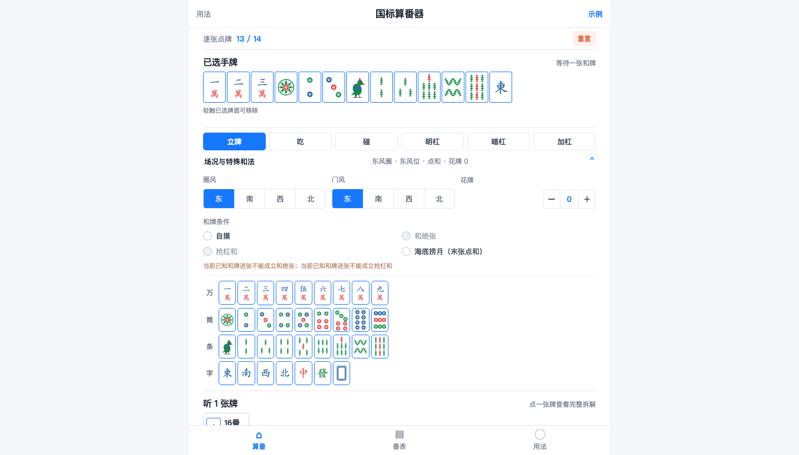

# MCR Mahjong Calculator

面向 MCR（Mahjong Competition Rules，中国官方麻将竞赛规则）的纯前端算番器与 81 番种表。算番无需本站后端、账号、数据库或运行时 API。

[国内访问推荐](https://tech.wenmq.cn/mcr-mahjong-calculator/) · [ChatGPT 部署版（备用）](https://guobiao-mahjong-calculator.firehorsek.chatgpt.site/)

<p align="center">
  
</p>

<p align="center">
  
</p>

> 两张预览图由构建后的离线页面在固定移动端和桌面视口中离屏渲染导出，不包含浏览器界面或用户牌局数据。

- 移动优先：逐张点选 34 种标准牌；选满 13 张自动查听，选满 14 张自动列出番种。已选手牌在移动端单行自适应排版，按键支持 `touch-action: manipulation` 消除点击延迟。
- 副露与场况：可按吃、碰、明杠、暗杠逐副录入；圈风、门风、花牌与和牌条件可补充设置，排斥不可能组合（详见 [场况番种与互斥规则](docs/scoring-context.md)）。
- 算番防护：自动修补底层引擎一色四节高缺少递增序数校验的 bug（2346 条正确计三节高，2345 条计四节高）。
- 牌面：使用站内自制的单一 SVG 精灵库 `src/mahjong-sprite.svg`，按键、已选手牌与结果共用，不裁切或依赖第三方牌图资源。
- 分享：用法页提供入口二维码和复制链接；在其他设备打开后重新录入牌局，不同步当前手牌。

## 离线使用

普通用户不需要下载或打开 HTML 文件：先在支持 Service Worker 的浏览器中联网打开准备使用的入口，等待页面显示“离线缓存已就绪”，页面与算番资源就会保存在当前浏览器中。两种入口的缓存分别保存；之后断网时，请在同一浏览器重新打开首次联网使用的那个入口。

也可以按需将网页安装到设备主屏幕或应用列表，之后从图标启动；安装不是离线使用的前提。若浏览器数据被清除，或浏览器回收了站点缓存，需要重新联网打开页面并等待缓存就绪。

仓库中的 `dist/` 是部署构建产物；在源码页面打开 `dist/index.html` 只会查看 HTML 内容，不会运行算番器。普通用户优先使用上面的国内入口，也可选择 ChatGPT 备用版；首次联网缓存后即可离线打开。`src/index.html` 是开发源码，不是用户入口。

## 本地运行

```bash
npm ci
npm run build
python3 -m http.server 8080 --directory dist
```

## 开发检查

```bash
npm run check
npm run build
```

`check` 执行自动化测试与静态验证套件：
1. **自动补丁与引擎冒烟**（`smoke.mjs`）：校验常规和牌、顶级大番，以及一色四节高（递增校验）和绿一色等边界番种；
2. **场况规则与互斥逻辑**（`rules.mjs`）：校验圈风/门风组合、绝张/末张/杠牌冲突排除以及 8 番起和门槛；
3. **交互逻辑与打点安全**（`usage.mjs`）：校验状态机重置、样本隔离与手牌隐私保护；
4. **牌面几何规范**（`tiles.mjs`）：校验 144 张牌的 SVG 阵型布局与配色规范；
5. **打包交付完整性**（`check.mjs`）：校验无网络 API 泄露、离线精灵内联及单行 14 张手牌自适应排版。

## 依赖与许可

计算核心使用 `gb-mahjong-js` 的 MIT 许可 JavaScript 规则层；说明见 [THIRD-PARTY-NOTICES.md](THIRD-PARTY-NOTICES.md)。本站不使用后端、账号、数据库或运行时 API。

本仓库当前未为项目自有代码和素材设置开源许可证。公开可见不等于授予再分发或派生权；第三方依赖仍各自遵循原许可。

## 使用统计事件

工具只派发本地 `mcr:usage` 事件：开始录牌、生成合法听牌或和牌结果、加载示例、成功复制分享链接。纯源码和离线版本不会主动连接统计服务。部署方可以显式接入现有 GA4；统计字段只包含操作类型、手动或示例模式、结果类型，不上传牌面或内部去重签名。

相同局面反复渲染不会重复记录结果；清空后重录是一局新的计算。示例和对示例的修改单独标记，避免把示例演示解释成自主录牌。事件发送失败不会中断算番。`npm run check` 包含去重、示例隔离和采集异常检查。
